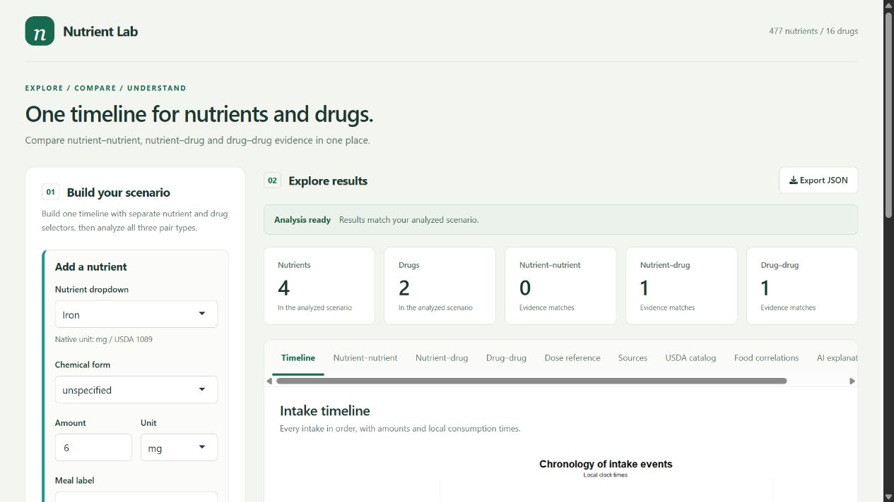

# nutriIntR

Run the nutrient–nutrient, nutrient–drug and drug–drug interaction explorer locally.

## Download and run with Docker

### 1. Install the prerequisites

Install:

- [Git](https://git-scm.com/downloads)
- [Docker Desktop](https://www.docker.com/products/docker-desktop/) with Linux containers
- [Ollama](https://ollama.com/download) only if you want the optional local AI explanation

### 2. Download the project

The repository is private, so your GitHub account must have access for the download. Clone it:

```sh
git clone https://github.com/Kan-sar/nutriIntR.git
cd nutriIntR
```

Alternatively, open the repository on GitHub, choose **Code → Download ZIP**, extract it and open a terminal in the extracted `nutriIntR` folder.

After the project is downloaded, running it does not require a GitHub login.

### 3. Optionally install the local AI model

Start Ollama, then run:

```sh
ollama pull deepseek-r1:1.5b
```

Skip this step if you do not need the AI explanation tab. The deterministic interaction engine still works.

### 4. Build and start the project

From the project folder, run:

```sh
docker compose up --build -d --wait --wait-timeout 120
```

The first build can take several minutes while R dependencies and the checked dataset are restored.

### 5. Open the application

- Dashboard: [http://localhost:3838](http://localhost:3838)
- API health check: [http://localhost:8000/health](http://localhost:8000/health)

### 6. Verify that both services are running

```sh
docker compose ps
```

Both `app` and `api` should report `healthy`. To inspect their output:

```sh
docker compose logs -f
```

### 7. Stop the project

```sh
docker compose down
```

## Run directly with R instead

### 1. Install R 4.6.1 and Git

RStudio is optional.

### 2. Download the project and restore its packages

```sh
git clone https://github.com/Kan-sar/nutriIntR.git
cd nutriIntR
Rscript scripts/restore_environment.R
```

### 3. Start the dashboard

```sh
Rscript scripts/serve_app.R
```

Open [http://127.0.0.1:3838](http://127.0.0.1:3838).

### 4. Optionally start the API in a second terminal

```sh
Rscript scripts/serve_api.R
```

The API will be available at [http://127.0.0.1:8000](http://127.0.0.1:8000).

## Screenshot



## Notes

- The AI layer is optional and runs locally through Ollama.
- Uncataloged interaction pairs are reported as unknown, not safe.
- MIT-licensed source code; source datasets retain their recorded licenses.
