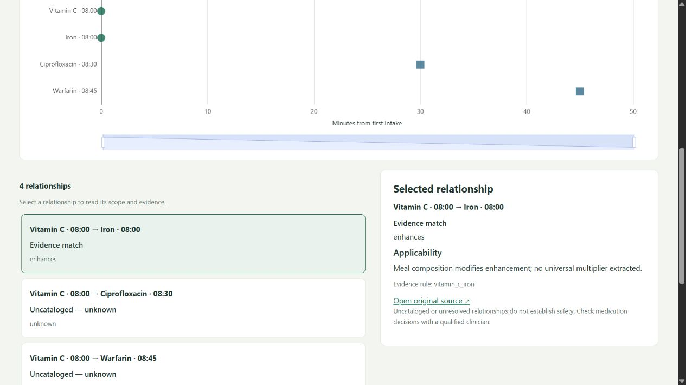

# nutriIntR

Run the nutrient–nutrient, nutrient–drug and drug–drug interaction explorer locally.

## Manage your intakes

The dashboard starts empty, with no sample nutrients, medications, doses or times.
Use **Your intakes** to add a nutrient or medication, review the draft timeline,
and edit or remove each intake directly. Required timing appears before the Add
button. **Analyze scenario** opens **Findings**, where the interactive timeline,
relationship filters, network and matrix connect to an evidence panel. The findings
list offers the same relationships without requiring chart interaction.

**Evidence** contains source catalogs and dose references. **Explore** contains the
nutrient catalog and food correlations. Raw scenario editing and reset are under
**Advanced scenario controls**; analyzed JSON export is available with current results.

Edits preserve intake IDs and clear previous findings, chart selections, AI explanations,
and export availability. Analyze again to refresh. Analysis requires at least one
nutrient; medication-only drafts can still be edited and previewed. Examples remain
available under `inst/extdata/` and are not loaded automatically.

Interactive charts use the pinned `echarts4r` package and bundled browser assets.
See [the UX implementation and validation notes](docs/UX_REDESIGN.md).

## Download and run with Docker

### 1. Install the prerequisites

Install:

- [Git](https://git-scm.com/downloads)
- [Docker Desktop](https://www.docker.com/products/docker-desktop/) with Linux containers
- [Ollama](https://ollama.com/download) only if you want the optional local AI explanation

### 2. Download the project

The repository is private, so your GitHub account must have access for the download. Clone it:

```sh
git clone https://github.com/Kan-sar/nutriIntR.git
cd nutriIntR
```

Alternatively, open the repository on GitHub, choose **Code → Download ZIP**, extract it and open a terminal in the extracted `nutriIntR` folder.

After the project is downloaded, running it does not require a GitHub login.

### 3. Optionally install the local AI model

Start Ollama, then run:

```sh
ollama pull deepseek-r1:1.5b
```

Skip this step if you do not need the AI explanation tab. The deterministic interaction engine still works.

### 4. Build and start the project

From the project folder, run:

```sh
docker compose up --build -d --wait --wait-timeout 120
```

The first build can take several minutes while R dependencies and the checked dataset are restored.

### 5. Open the application

- Dashboard: [http://localhost:3838](http://localhost:3838)
- API health check: [http://localhost:8000/health](http://localhost:8000/health)

### 6. Verify that both services are running

```sh
docker compose ps
```

Both `app` and `api` should report `healthy`. To inspect their output:

```sh
docker compose logs -f
```

### 7. Stop the project

```sh
docker compose down
```

## Run with RStudio

### 1. Install the prerequisites

Install:

- [R 4.6.1](https://cran.r-project.org/)
- [RStudio Desktop](https://posit.co/download/rstudio-desktop/)
- [Git](https://git-scm.com/downloads) if you want to clone instead of downloading a ZIP
- [Ollama](https://ollama.com/download) only if you want the optional local AI explanation

Restart RStudio after installing R.

### 2. Download the project

The repository is private, so your GitHub account must have access for the download. Choose one method:

**Clone with Git:**

1. Open RStudio.
2. Select **File → New Project → Version Control → Git**.
3. Enter `https://github.com/Kan-sar/nutriIntR.git` as the repository URL.
4. Choose a local folder and select **Create Project**.

**Download a ZIP:**

1. Open the repository on GitHub and select **Code → Download ZIP**.
2. Extract the ZIP to a permanent folder.
3. In RStudio, select **File → Open Project**.
4. Open `nutrient-engine.Rproj` from the extracted folder.

After the project is downloaded, running it does not require a GitHub login.

### 3. Confirm that the project is open

The RStudio Console should show the project directory when you run:

```r
getwd()
```

The displayed folder should contain `nutrient-engine.Rproj`. If it does not, open that project file before continuing.

### 4. Restore the R packages

In the RStudio Console, run:

```r
source("scripts/restore_environment.R")
```

Type `y` if R asks to install or activate `renv`. The first restore can take several minutes. Wait until the `>` prompt returns without an error.

### 5. Optionally install the local AI model

Start Ollama, then open the RStudio Terminal using **Tools → Terminal → New Terminal** and run:

```sh
ollama pull deepseek-r1:1.5b
```

Skip this step if you do not need AI explanations. The interaction engine works without Ollama.

### 6. Start the dashboard

In the RStudio Console, run:

```r
source("scripts/serve_app.R")
```

Open [http://127.0.0.1:3838](http://127.0.0.1:3838) in a browser. Keep the Console running while using the dashboard.

### 7. Optionally start the API

Open **Tools → Terminal → New Terminal** and run:

```sh
Rscript scripts/serve_api.R
```

Verify it at [http://127.0.0.1:8000/health](http://127.0.0.1:8000/health).

### 8. Stop the project

Click the red **Stop** button above the RStudio Console to stop the dashboard. In the API terminal, press **Ctrl+C** to stop the API.

## Screenshot



## Notes

- The AI layer is optional and runs locally through Ollama.
- Uncataloged interaction pairs are reported as unknown, not safe.
- MIT-licensed source code; source datasets retain their recorded licenses.
